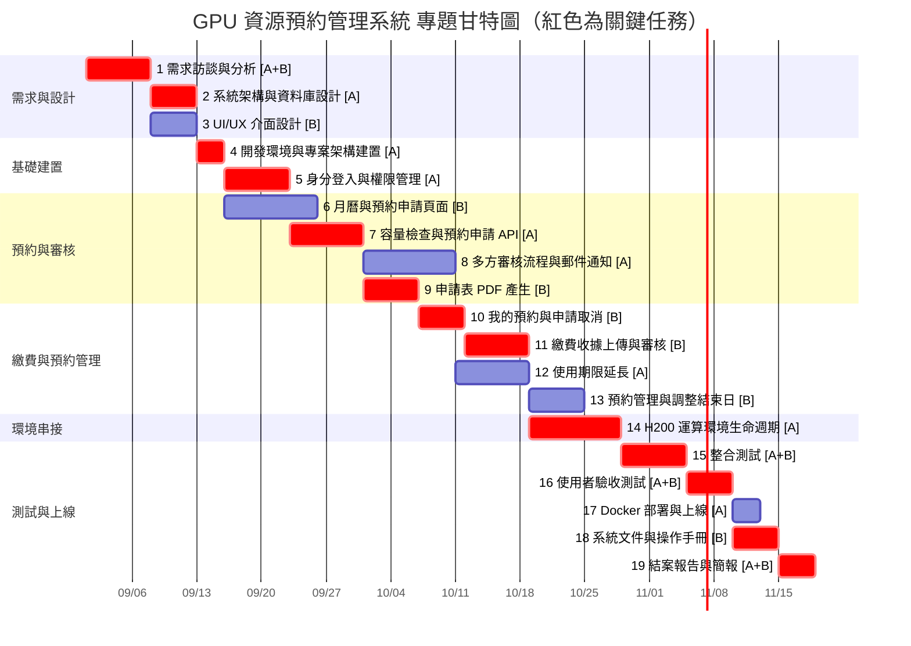

# 小組作業2 GPU 資源預約管理系統：專題任務分工、甘特圖與 PERT/CPM 圖

## 一、組員分工

| 組員 | 角色 | 主要負責 |
|:---:|:---|:---|
| 莊芸禎 | 後端 / 系統整合 | 系統架構、資料庫、FastAPI、審核流程、延長申請、H200 環境串接、Docker 部署 |
| 洪淑媛 | 前端 / 文件 | UI/UX、React 頁面、PDF 申請表、收據審核、預約管理、操作手冊 |
| 兩人 | 共同 | 需求分析、整合測試、使用者驗收測試、結案報告 |

---

## 二、工作分解結構（WBS）

| 任務 | 說明 | 負責 | 需時（天） | 前置任務 | 產出 |
|:---:|:---|:---:|:---:|:---:|:---|
| 1 | 需求訪談與分析 | A + B | 7 | - | 需求規格書、角色與權限表、使用流程 |
| 2 | 系統架構與資料庫設計 | A | 5 | 1 | 架構圖、PostgreSQL ER 圖 |
| 3 | UI/UX 介面設計 | B | 5 | 1 | Wireframe、頁面流程 |
| 4 | 開發環境與專案架構建置 | A | 3 | 2 | React + Vite、FastAPI 專案骨架、Git 版控 |
| 5 | 身分登入與權限管理 | A | 7 | 4 | Google 登入、校園 SSO、角色權限控管 |
| 6 | 資源查詢月曆與預約申請頁面 | B | 10 | 3, 4 | 剩餘 GI 月曆、1–14 GI 選單、申請表單與欄位檢核 |
| 7 | 容量檢查與預約申請 API | A | 8 | 5 | 後端容量檢查、費用計算、密碼加密儲存 |
| 8 | 多方審核流程與郵件通知 | A | 10 | 7 | 初審／最終審核、逾期自動核准、Gmail 通知 |
| 9 | 申請表 PDF 產生 | B | 6 | 6, 7 | Word 範本、LibreOffice 轉 PDF、自動計算金額 |
| 10 | 我的預約與申請取消 | B | 5 | 9 | 我的預約頁面、依狀態判斷可否取消 |
| 11 | 繳費收據上傳與審核 | B | 7 | 8, 10 | 收據上傳、承辦人核准／拒絕、重新上傳 |
| 12 | 使用期限延長 | A | 8 | 8, 9 | 延長申請、延長申請表範本、容量重新確認 |
| 13 | 預約管理與調整使用結束日 | B | 6 | 11 | 預約查詢、結束日調整、操作紀錄 |
| 14 | H200 運算環境生命週期串接 | A | 10 | 11 | 環境啟用／關閉排程、連線通知、失敗重試 |
| 15 | 整合測試 | A + B | 7 | 12, 13, 14 | 測試案例、Bug 修正紀錄 |
| 16 | 使用者驗收測試（UAT） | A + B | 5 | 15 | 驗收回饋、修正版本 |
| 17 | Docker 部署與上線 | A | 3 | 16 | Docker Compose、反向代理設定 |
| 18 | 系統文件與操作手冊 | B | 5 | 16 | 申請人／審核人員／承辦人操作手冊 |
| 19 | 結案報告與簡報 | A + B | 4 | 17, 18 | 結案報告、簡報、展示影片 |

> 前置任務除了功能上的相依，也考慮了人力安排，讓同一位組員不會同時做兩項任務。

---

## 三、個別組員任務

### 組員 A（後端 / 系統整合）

| 任務 | 說明 | 需時 | 期間 |
|:---:|:---|:---:|:---:|
| 1 | 需求訪談與分析（共同） | 7 | 09/01 – 09/07 |
| 2 | 系統架構與資料庫設計 | 5 | 09/08 – 09/12 |
| 4 | 開發環境與專案架構建置 | 3 | 09/13 – 09/15 |
| 5 | 身分登入與權限管理 | 7 | 09/16 – 09/22 |
| 7 | 容量檢查與預約申請 API | 8 | 09/23 – 09/30 |
| 8 | 多方審核流程與郵件通知 | 10 | 10/01 – 10/10 |
| 12 | 使用期限延長 | 8 | 10/11 – 10/18 |
| 14 | H200 運算環境生命週期串接 | 10 | 10/19 – 10/28 |
| 15 | 整合測試（共同） | 7 | 10/29 – 11/04 |
| 16 | 使用者驗收測試（共同） | 5 | 11/05 – 11/09 |
| 17 | Docker 部署與上線 | 3 | 11/10 – 11/12 |
| 19 | 結案報告與簡報（共同） | 4 | 11/15 – 11/18 |

**合計：77 天**（個人 54 天 + 共同 23 天）

### 組員 B（前端 / 文件）

| 任務 | 說明 | 需時 | 期間 |
|:---:|:---|:---:|:---:|
| 1 | 需求訪談與分析（共同） | 7 | 09/01 – 09/07 |
| 3 | UI/UX 介面設計 | 5 | 09/08 – 09/12 |
| 6 | 資源查詢月曆與預約申請頁面 | 10 | 09/16 – 09/25 |
| 9 | 申請表 PDF 產生 | 6 | 10/01 – 10/06 |
| 10 | 我的預約與申請取消 | 5 | 10/07 – 10/11 |
| 11 | 繳費收據上傳與審核 | 7 | 10/12 – 10/18 |
| 13 | 預約管理與調整使用結束日 | 6 | 10/19 – 10/24 |
| 15 | 整合測試（共同） | 7 | 10/29 – 11/04 |
| 16 | 使用者驗收測試（共同） | 5 | 11/05 – 11/09 |
| 18 | 系統文件與操作手冊 | 5 | 11/10 – 11/14 |
| 19 | 結案報告與簡報（共同） | 4 | 11/15 – 11/18 |

**合計：67 天**（個人 44 天 + 共同 23 天）

---

## 四、CPM 時間計算

- **順推**：ES = 所有前置任務 EF 中的最大值；EF = ES + 需時
- **逆推**：LF = 所有後續任務 LS 中的最小值；LS = LF − 需時
- **寬裕時間（Slack）** = LS − ES；Slack = 0 的任務就是關鍵任務

| 任務 | 說明 | 需時 | ES | EF | LS | LF | Slack | 關鍵 |
|:---:|:---|:---:|:---:|:---:|:---:|:---:|:---:|:---:|
| 1 | 需求訪談與分析 | 7 | 0 | 7 | 0 | 7 | 0 | ✅ |
| 2 | 系統架構與資料庫設計 | 5 | 7 | 12 | 7 | 12 | 0 | ✅ |
| 3 | UI/UX 介面設計 | 5 | 7 | 12 | 15 | 20 | 8 | |
| 4 | 開發環境與專案架構建置 | 3 | 12 | 15 | 12 | 15 | 0 | ✅ |
| 5 | 身分登入與權限管理 | 7 | 15 | 22 | 15 | 22 | 0 | ✅ |
| 6 | 資源查詢月曆與預約申請頁面 | 10 | 15 | 25 | 20 | 30 | 5 | |
| 7 | 容量檢查與預約申請 API | 8 | 22 | 30 | 22 | 30 | 0 | ✅ |
| 8 | 多方審核流程與郵件通知 | 10 | 30 | 40 | 31 | 41 | 1 | |
| 9 | 申請表 PDF 產生 | 6 | 30 | 36 | 30 | 36 | 0 | ✅ |
| 10 | 我的預約與申請取消 | 5 | 36 | 41 | 36 | 41 | 0 | ✅ |
| 11 | 繳費收據上傳與審核 | 7 | 41 | 48 | 41 | 48 | 0 | ✅ |
| 12 | 使用期限延長 | 8 | 40 | 48 | 50 | 58 | 10 | |
| 13 | 預約管理與調整使用結束日 | 6 | 48 | 54 | 52 | 58 | 4 | |
| 14 | H200 運算環境生命週期串接 | 10 | 48 | 58 | 48 | 58 | 0 | ✅ |
| 15 | 整合測試 | 7 | 58 | 65 | 58 | 65 | 0 | ✅ |
| 16 | 使用者驗收測試 | 5 | 65 | 70 | 65 | 70 | 0 | ✅ |
| 17 | Docker 部署與上線 | 3 | 70 | 73 | 72 | 75 | 2 | |
| 18 | 系統文件與操作手冊 | 5 | 70 | 75 | 70 | 75 | 0 | ✅ |
| 19 | 結案報告與簡報 | 4 | 75 | 79 | 75 | 79 | 0 | ✅ |

---

## 五、PERT/CPM 圖

紅色節點與粗線為關鍵路徑；綠色為組員 A，藍色為組員 B。

```mermaid
flowchart LR
    T1["<b>1 需求訪談與分析</b><br/>A+B ｜ 7天<br/>ES 0 ｜ EF 7<br/>LS 0 ｜ LF 7<br/>Slack 0"]
    T2["<b>2 架構與資料庫設計</b><br/>A ｜ 5天<br/>ES 7 ｜ EF 12<br/>LS 7 ｜ LF 12<br/>Slack 0"]
    T3["<b>3 UI/UX 介面設計</b><br/>B ｜ 5天<br/>ES 7 ｜ EF 12<br/>LS 15 ｜ LF 20<br/>Slack 8"]
    T4["<b>4 開發環境建置</b><br/>A ｜ 3天<br/>ES 12 ｜ EF 15<br/>LS 12 ｜ LF 15<br/>Slack 0"]
    T5["<b>5 登入與權限管理</b><br/>A ｜ 7天<br/>ES 15 ｜ EF 22<br/>LS 15 ｜ LF 22<br/>Slack 0"]
    T6["<b>6 月曆與預約頁面</b><br/>B ｜ 10天<br/>ES 15 ｜ EF 25<br/>LS 20 ｜ LF 30<br/>Slack 5"]
    T7["<b>7 容量與預約 API</b><br/>A ｜ 8天<br/>ES 22 ｜ EF 30<br/>LS 22 ｜ LF 30<br/>Slack 0"]
    T8["<b>8 多方審核與通知</b><br/>A ｜ 10天<br/>ES 30 ｜ EF 40<br/>LS 31 ｜ LF 41<br/>Slack 1"]
    T9["<b>9 申請表 PDF</b><br/>B ｜ 6天<br/>ES 30 ｜ EF 36<br/>LS 30 ｜ LF 36<br/>Slack 0"]
    T10["<b>10 我的預約與取消</b><br/>B ｜ 5天<br/>ES 36 ｜ EF 41<br/>LS 36 ｜ LF 41<br/>Slack 0"]
    T11["<b>11 收據上傳與審核</b><br/>B ｜ 7天<br/>ES 41 ｜ EF 48<br/>LS 41 ｜ LF 48<br/>Slack 0"]
    T12["<b>12 使用期限延長</b><br/>A ｜ 8天<br/>ES 40 ｜ EF 48<br/>LS 50 ｜ LF 58<br/>Slack 10"]
    T13["<b>13 預約管理與調整結束日</b><br/>B ｜ 6天<br/>ES 48 ｜ EF 54<br/>LS 52 ｜ LF 58<br/>Slack 4"]
    T14["<b>14 H200 環境串接</b><br/>A ｜ 10天<br/>ES 48 ｜ EF 58<br/>LS 48 ｜ LF 58<br/>Slack 0"]
    T15["<b>15 整合測試</b><br/>A+B ｜ 7天<br/>ES 58 ｜ EF 65<br/>LS 58 ｜ LF 65<br/>Slack 0"]
    T16["<b>16 使用者驗收測試</b><br/>A+B ｜ 5天<br/>ES 65 ｜ EF 70<br/>LS 65 ｜ LF 70<br/>Slack 0"]
    T17["<b>17 Docker 部署上線</b><br/>A ｜ 3天<br/>ES 70 ｜ EF 73<br/>LS 72 ｜ LF 75<br/>Slack 2"]
    T18["<b>18 系統文件與手冊</b><br/>B ｜ 5天<br/>ES 70 ｜ EF 75<br/>LS 70 ｜ LF 75<br/>Slack 0"]
    T19["<b>19 結案報告與簡報</b><br/>A+B ｜ 4天<br/>ES 75 ｜ EF 79<br/>LS 75 ｜ LF 79<br/>Slack 0"]

    T1 --> T2
    T1 --> T3
    T2 --> T4
    T3 --> T6
    T4 --> T5
    T4 --> T6
    T5 --> T7
    T6 --> T9
    T7 --> T8
    T7 --> T9
    T8 --> T11
    T8 --> T12
    T9 --> T10
    T9 --> T12
    T10 --> T11
    T11 --> T13
    T11 --> T14
    T12 --> T15
    T13 --> T15
    T14 --> T15
    T15 --> T16
    T16 --> T17
    T16 --> T18
    T17 --> T19
    T18 --> T19

    classDef crit fill:#ffe0e0,stroke:#d00,stroke-width:3px,color:#000
    classDef memA fill:#e6f7e6,stroke:#2e7d32,color:#000
    classDef memB fill:#e6f0ff,stroke:#1e5bb8,color:#000
    class T1,T2,T4,T5,T7,T9,T10,T11,T14,T15,T16,T18,T19 crit
    class T8,T12,T17 memA
    class T3,T6,T13 memB
    linkStyle 0,2,4,6,9,12,14,16,19,20,22,24 stroke:#d00,stroke-width:4px
```

---

## 六、專題甘特圖

假設專題從 **2026-09-01** 開始，以日曆天計算。

| 任務 | 說明 | 負責 | 開始日期 | 結束日期 | 需時 |
|:---:|:---|:---:|:---:|:---:|:---:|
| 1 | 需求訪談與分析 | A + B | 2026-09-01 | 2026-09-07 | 7 |
| 2 | 系統架構與資料庫設計 | A | 2026-09-08 | 2026-09-12 | 5 |
| 3 | UI/UX 介面設計 | B | 2026-09-08 | 2026-09-12 | 5 |
| 4 | 開發環境與專案架構建置 | A | 2026-09-13 | 2026-09-15 | 3 |
| 5 | 身分登入與權限管理 | A | 2026-09-16 | 2026-09-22 | 7 |
| 6 | 資源查詢月曆與預約申請頁面 | B | 2026-09-16 | 2026-09-25 | 10 |
| 7 | 容量檢查與預約申請 API | A | 2026-09-23 | 2026-09-30 | 8 |
| 8 | 多方審核流程與郵件通知 | A | 2026-10-01 | 2026-10-10 | 10 |
| 9 | 申請表 PDF 產生 | B | 2026-10-01 | 2026-10-06 | 6 |
| 10 | 我的預約與申請取消 | B | 2026-10-07 | 2026-10-11 | 5 |
| 11 | 繳費收據上傳與審核 | B | 2026-10-12 | 2026-10-18 | 7 |
| 12 | 使用期限延長 | A | 2026-10-11 | 2026-10-18 | 8 |
| 13 | 預約管理與調整使用結束日 | B | 2026-10-19 | 2026-10-24 | 6 |
| 14 | H200 運算環境生命週期串接 | A | 2026-10-19 | 2026-10-28 | 10 |
| 15 | 整合測試 | A + B | 2026-10-29 | 2026-11-04 | 7 |
| 16 | 使用者驗收測試 | A + B | 2026-11-05 | 2026-11-09 | 5 |
| 17 | Docker 部署與上線 | A | 2026-11-10 | 2026-11-12 | 3 |
| 18 | 系統文件與操作手冊 | B | 2026-11-10 | 2026-11-14 | 5 |
| 19 | 結案報告與簡報 | A + B | 2026-11-15 | 2026-11-18 | 4 |

---

## 七、關鍵路徑

**1 → 2 → 4 → 5 → 7 → 9 → 10 → 11 → 14 → 15 → 16 → 18 → 19**

7 + 5 + 3 + 7 + 8 + 6 + 5 + 7 + 10 + 7 + 5 + 5 + 4 = **79 天**

- 專題最短完成時間為 **79 天**（2026-09-01 至 2026-11-18）。
- 關鍵路徑上的任務 Slack 都是 0，只要其中任何一項延誤，整個專題就會延後。
- 寬裕時間較多的任務：12 使用期限延長（10 天）、3 UI/UX 介面設計（8 天）、6 月曆與預約頁面（5 天）、13 預約管理（4 天）。
- 任務 12 雖然有 10 天寬裕，但組員 A 在 10/19 就要接著做任務 14（關鍵任務），所以任務 12 最好在 10/18 前完成，不要把寬裕時間用掉。
