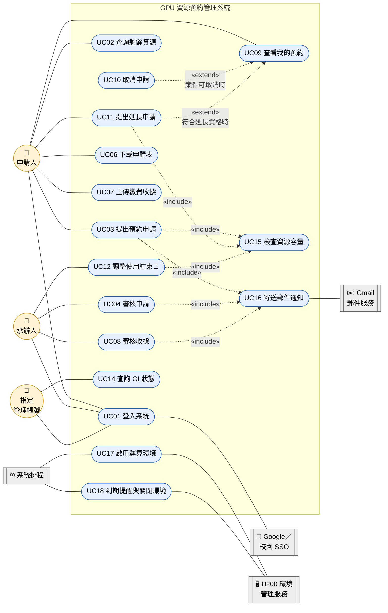

# 小組作業3：GPU 資源預約管理系統

## 一、系統需求
### 一、功能性需求（Functional Requirements）

| 編號 | 需求名稱 | 需求描述 | 相關角色 |
|:---:|:---|:---|:---:|
| FR-01 | 身分登入與權限控管 | 系統應提供 Google 帳號登入及校園入口網站單一登入（SSO），並依校方帳號資料確認使用資格；不同角色只能存取自己權限範圍內的資料與功能。 | 全體使用者 |
| FR-02 | 資源查詢與線上預約 | 系統應以月曆顯示每日剩餘 GI，讓申請人選擇 1–14 GI 及連續使用日期，並顯示租借天數與預估費用。一般申請至少須提前 2 天，每次最多 7 天；送出時由後端再次檢查容量。 | 申請人 |
| FR-03 | 承辦人審核與結果通知 | 申請送出後，系統應通知承辦人進行審核。承辦人可選擇同意或拒絕，拒絕時必須填寫原因。承辦人同意後即代表申請審核通過，案件直接進入待繳費階段；拒絕時則將案件設為審核未通過，並寄送審核結果通知。 | 承辦人 |
| FR-04 | 申請表 PDF 產生與下載 | 審核通過後，系統應依 Word 範本自動產生申請表 PDF，帶入申請人資料、使用期間、GI 數量及金額（每 GI 每天 300 元 × GI 數量 × 天數）。一般申請與延長申請使用不同範本。 | 申請人 |
| FR-05 | 繳費收據上傳與審核 | 申請人應能上傳繳費收據，由承辦人核准或拒絕；收據遭拒絕後，申請人可以重新上傳。收據審核清單預設只顯示待審核的案件。 | 申請人、承辦人 |
| FR-06 | 使用期限延長 | 系統應允許符合資格的預約提出延長申請，每次最多 7 天，沿用原本的 GI 數量，並在送出、承辦人審核通過及收據核准時重新確認容量；收據核准後才正式更新使用截止日。 | 申請人、承辦人 |
| FR-07 | 承辦人調整使用結束日 | 承辦人應能對收據已核准、尚未到期的預約調整使用結束日，不額外收費。系統應記錄操作人、時間、調整前後日期及原因，並通知申請人。 | 承辦人 |
| FR-08 | 運算環境生命週期管理 | 系統應串接 H200 環境管理服務，依已核准繳費的預約自動啟用環境、寄送連線資訊，並在到期前提醒、到期後關閉環境。 | 系統排程、管理人員 |

---

### 二、非功能性需求（Non-Functional Requirements）

| 編號 | 類別 | 需求描述 | 驗收標準 |
|:---:|:---:|:---|:---|
| NFR-01 | 安全性 | 連線密碼應加密儲存；承辦人透過審核連結操作時仍須登入並通過身分與權限驗證，不得只憑連結直接操作；所有 API 都應依角色檢查權限。 | 資料庫中沒有明文密碼；未登入或權限不足時，API 回傳 401／403。 |
| NFR-02 | 資料一致性 | 容量檢查以後端為準，不可只依前端顯示判斷是否可預約；多人同時預約同一日期時，不得超額配置 GI。 | 同時送出的申請總量不會超過當日可用的 GI。 |
| NFR-03 | 可用性（易用性） | 介面應以月曆、下拉選單等直覺操作完成申請；必填欄位、資料格式及欄位關聯（例如計畫經費代碼與請購編號須成對填寫）應即時提示錯誤。 | 新使用者不看手冊也能完成一次預約申請。 |
| NFR-04 | 可靠性 | H200 環境操作應具備狀態回報、失敗重試及異常通知；郵件寄送失敗時應記錄錯誤，方便追查。 | 環境啟用失敗時會自動重試，並寄送異常通知給管理人員。 |
| NFR-05 | 效能 | 一般頁面與 API 查詢的回應時間應在合理範圍內；預約管理及收據審核清單應提供查詢、篩選與分頁。 | 一般操作在 3 秒內回應；資料量增加時，清單仍以分頁正常載入。 |
| NFR-06 | 可稽核性 | 申請審核、取消、收據審核、使用結束日調整等重要操作，都應保留操作人、時間及前後狀態紀錄。 | 每一筆狀態變更都能查到對應的紀錄。 |
| NFR-07 | 可維護性與可部署性 | 系統採前後端分離（React + Vite／FastAPI／PostgreSQL），後端以 Docker Compose 部署，前端以靜態網頁搭配反向代理提供服務。 | 依部署文件能在新主機上重新建置並啟動系統。 |
| NFR-08 | 在地化 | 所有日期與時間一律以台灣時區（UTC+8）呈現與計算。 | 跨日期的預約與到期判斷都以台灣時間為準。 |

---

## 二、功能分解圖
### 一、功能分解圖

```mermaid
flowchart LR
    ROOT["<b>GPU 資源預約<br/>管理系統</b>"]

    ROOT --> M1["<b>1.0 身分登入與權限管理</b>"]
    ROOT --> M2["<b>2.0 資源查詢與線上預約</b>"]
    ROOT --> M3["<b>3.0 承辦人審核管理</b>"]
    ROOT --> M4["<b>4.0 申請表文件管理</b>"]
    ROOT --> M5["<b>5.0 繳費收據管理</b>"]
    ROOT --> M6["<b>6.0 我的預約管理</b>"]
    ROOT --> M7["<b>7.0 使用期限延長</b>"]
    ROOT --> M8["<b>8.0 承辦人預約管理</b>"]
    ROOT --> M9["<b>9.0 運算環境生命週期管理</b>"]
    ROOT --> M10["<b>10.0 通知與系統管理</b>"]

    M1 --> F11["1.1 Google 帳號登入"]
    M1 --> F12["1.2 校園入口 SSO 登入"]
    M1 --> F13["1.3 校方帳號資格驗證"]
    M1 --> F14["1.4 角色權限控管"]

    M2 --> F21["2.1 月曆查詢每日剩餘 GI"]
    M2 --> F22["2.2 選擇 GI 數量（1–14）"]
    M2 --> F23["2.3 選擇連續使用日期"]
    M2 --> F24["2.4 計算天數與預估費用"]
    M2 --> F25["2.5 填寫申請資料與欄位檢核"]
    M2 --> F26["2.6 後端容量檢查與送出"]

    M3 --> F31["3.1 通知承辦人審核"]
    M3 --> F32["3.2 承辦人審核（同意／拒絕）"]
    M3 --> F33["3.3 更新申請審核狀態"]

    M4 --> F41["4.1 一般申請表產生"]
    M4 --> F42["4.2 延長申請表產生"]
    M4 --> F43["4.3 自動計算金額"]
    M4 --> F44["4.4 Word 轉 PDF 下載"]

    M5 --> F51["5.1 上傳繳費收據"]
    M5 --> F52["5.2 承辦人收據審核"]
    M5 --> F53["5.3 收據退件重新上傳"]
    M5 --> F54["5.4 待審核清單篩選"]

    M6 --> F61["6.1 查看申請與進度"]
    M6 --> F62["6.2 下載申請表／上傳收據"]
    M6 --> F63["6.3 取消一般申請"]
    M6 --> F64["6.4 取消延長申請"]

    M7 --> F71["7.1 檢查延長資格與範圍"]
    M7 --> F72["7.2 提出延長申請（最多 7 天）"]
    M7 --> F73["7.3 延長期間容量檢查"]
    M7 --> F74["7.4 更新使用截止日"]

    M8 --> F81["8.1 搜尋與篩選預約"]
    M8 --> F82["8.2 調整使用結束日"]
    M8 --> F83["8.3 保留調整操作紀錄"]

    M9 --> F91["9.1 排程啟用 H200 環境"]
    M9 --> F92["9.2 環境狀態回報"]
    M9 --> F93["9.3 寄送連線資訊"]
    M9 --> F94["9.4 到期提醒與關閉"]
    M9 --> F95["9.5 失敗重試與異常通知"]

    M10 --> F101["10.1 審核待辦／結果通知"]
    M10 --> F102["10.2 到期與日期調整通知"]
    M10 --> F104["10.3 GI 狀態查詢（指定帳號）"]

    classDef root fill:#1e3a5f,stroke:#1e3a5f,color:#fff,font-size:16px
    classDef module fill:#dbe8f7,stroke:#1e5bb8,stroke-width:2px,color:#000
    classDef func fill:#ffffff,stroke:#8aa4c8,color:#000
    class ROOT root
    class M1,M2,M3,M4,M5,M6,M7,M8,M9,M10 module
    class F11,F12,F13,F14,F21,F22,F23,F24,F25,F26,F31,F32,F33,F41,F42,F43,F44,F51,F52,F53,F54,F61,F62,F63,F64,F71,F72,F73,F74,F81,F82,F83,F91,F92,F93,F94,F95,F101,F102,F104 func
```

---

### 二、功能分解說明

| 編號 | 功能模組 | 子功能 | 使用角色 |
|:---:|:---|:---|:---:|
| 1.0 | 身分登入與權限管理 | Google 登入、校園 SSO、帳號資格驗證、角色權限控管 | 全體使用者 |
| 2.0 | 資源查詢與線上預約 | 剩餘 GI 月曆、GI 數量與日期選擇、費用試算、申請資料檢核、後端容量檢查 | 申請人 |
| 3.0 | 承辦人審核管理 | 通知承辦人、同意或拒絕申請、更新申請審核狀態 | 承辦人 |
| 4.0 | 申請表文件管理 | 一般／延長申請表產生、金額自動計算、PDF 下載 | 申請人 |
| 5.0 | 繳費收據管理 | 收據上傳、收據審核、退件重新上傳、待審清單 | 申請人、承辦人 |
| 6.0 | 我的預約管理 | 查看進度、下載申請表、上傳收據、取消申請 | 申請人 |
| 7.0 | 使用期限延長 | 延長資格檢查、延長申請、容量重新確認、更新截止日 | 申請人 |
| 8.0 | 承辦人預約管理 | 搜尋預約、調整使用結束日、保留操作紀錄 | 承辦人 |
| 9.0 | 運算環境生命週期管理 | H200 環境啟用、狀態回報、連線通知、到期關閉、失敗重試 | 系統排程、管理人員 |
| 10.0 | 通知與系統管理 | 郵件通知、GI 狀態查詢 | 承辦人、指定管理帳號 |

## 三、使用案例圖與使用案例說明

### 一、參與者（Actors）

| 參與者 | 類型 | 說明 |
|:---|:---:|:---|
| 申請人 | 主要 | 本校教職員，負責查詢資源、提出申請、下載申請表、上傳收據、延長或取消申請 |
| 承辦人 | 主要 | 負責一般申請與延長申請審核、收據審核、預約管理及使用結束日調整 |
| 指定管理帳號 | 主要 | 可以查詢 GI 狀態 |
| Google／校園 SSO | 次要（外部系統） | 提供身分驗證 |
| H200 環境管理服務 | 次要（外部系統） | 實際啟用與關閉運算環境 |
| Gmail 郵件服務 | 次要（外部系統） | 寄送各類通知郵件 |
| 系統排程 | 次要（時間觸發） | 依時間自動執行環境啟用、到期提醒與關閉 |

---

### 二、使用案例圖

> **圖例**：實線代表參與者與使用案例的關聯；虛線 `«include»` 代表一定會一起執行的共用行為；虛線 `«extend»` 代表在特定條件下才會發生的延伸行為。

---

### 三、使用案例說明

#### UC03 提出預約申請

| 項目 | 內容 |
|:---|:---|
| **使用案例編號** | UC03 |
| **使用案例名稱** | 提出預約申請 |
| **主要參與者** | 申請人 |
| **次要參與者** | Gmail 郵件服務 |
| **描述** | 申請人選擇 GI 數量與使用日期，填寫申請資料後送出預約申請。 |
| **前置條件** | 1. 申請人已登入系統，並通過校方帳號資格驗證。 2. 所選的日期還有足夠的 GI 容量。 |
| **後置條件** | 1. 系統建立一筆「待審核」狀態的申請。 2. 系統寄送審核通知給承辦人。 |
| **包含（include）** | UC15 檢查資源容量、UC16 寄送郵件通知 |

**主要流程**

1. 申請人進入「線上預約」頁面。
2. 系統以月曆顯示每日剩餘 GI。
3. 申請人從下拉選單選擇 GI 數量（1–14）。
4. 申請人在月曆上選擇連續的使用日期。
5. 系統檢查所選日期的容量是否足夠，並顯示租借天數與預估費用。
6. 申請人填寫計畫／研究內容、單位、手機、連線帳號、連線密碼、校園來源 IP、主管資料及繳款資訊。
7. 申請人按下「送出申請」。
8. 系統檢核必填欄位、資料格式及欄位關聯。
9. 系統在後端再次檢查容量（include UC15）。
10. 系統加密儲存連線密碼，並建立申請紀錄。
11. 系統寄送審核通知給承辦人（include UC16）。
12. 系統顯示「申請已送出」，並導向「我的預約」。

**替代流程**

- **5a. 所選日期容量不足**：系統標示容量不足的日期，請申請人重新選擇日期或減少 GI 數量，回到步驟 3。
- **6a. 不使用計畫經費支付**：計畫經費代碼與請購編號可以同時留空。

**例外流程**

- **4a. 選擇的日期不到 2 天後**：系統提示「一般申請至少須提前兩天提出」，不讓申請人選擇。
- **4b. 選擇的天數超過 7 天**：系統提示「每次最多申請七天」。
- **8a. 欄位檢核失敗**：系統標示錯誤欄位與原因，回到步驟 6。
- **8b. 只填了計畫經費代碼或請購編號其中一項**：系統提示兩者須同時填寫或同時留空。
- **9a. 送出時容量已經被其他人預約走**：系統拒絕送出，並提示重新選擇日期，回到步驟 2。

**業務規則**

- 一般申請至少須提前 2 天提出，每次最多 7 天。
- 費用 = 每 GI 每天新臺幣 300 元 × GI 數量 × 計費天數。
- 日期與時間一律以台灣時區呈現。

---

#### UC04 審核申請

| 項目 | 內容 |
|:---|:---|
| **使用案例編號** | UC04 |
| **使用案例名稱** | 審核申請 |
| **主要參與者** | 承辦人 |
| **次要參與者** | Gmail 郵件服務 |
| **描述** | 承辦人檢視申請內容，選擇同意或拒絕；承辦人同意後即代表申請審核通過，系統依審核結果更新案件狀態。 |
| **前置條件** | 1. 承辦人已登入並通過身分驗證。 2. 申請處於「待審核」狀態，而且沒有被取消。 3. 操作者具有承辦人審核權限。 |
| **後置條件** | 1. 系統記錄承辦人的審核結果與時間。 2. 承辦人同意時，申請審核通過，案件直接進入「待繳費」狀態；拒絕時，案件進入「審核未通過」狀態。 3. 系統寄送審核結果通知給申請人。 |
| **包含（include）** | UC16 寄送郵件通知 |

**主要流程**

1. 承辦人點選通知郵件中的審核連結，或從系統進入待審清單。
2. 系統要求承辦人登入，並驗證其身分及審核權限。
3. 系統顯示申請內容：申請人、使用期間、GI 數量、金額、計畫／研究內容等。
4. 承辦人選擇「同意」。
5. 若為延長申請，系統重新確認延長期間的資源容量。
6. 系統記錄承辦人的審核結果與時間。
7. 申請審核通過，系統直接將案件更新為「待繳費」狀態。
8. 系統寄送審核通過通知給申請人（include UC16），申請人可以下載申請表。

**替代流程**

- **4a. 承辦人選擇「拒絕」**：
  1. 系統要求填寫拒絕原因。
  2. 承辦人填寫原因後送出。
  3. 系統記錄審核結果、拒絕原因及時間。
  4. 系統將案件更新為「審核未通過」狀態。
  5. 系統寄送審核結果及拒絕原因給申請人（include UC16）。

**例外流程**

- **2a. 操作者不具有承辦人權限**：系統拒絕存取，並顯示權限不足。
- **2b. 案件已經被取消**：系統顯示「此申請已取消」，不提供同意或拒絕按鈕。
- **4b. 拒絕時沒有填寫原因**：系統提示拒絕原因為必填，不讓送出。
- **5a. 延長期間的容量不足**：系統拒絕核准，並提示承辦人處理。

---

#### UC08 審核收據

| 項目 | 內容 |
|:---|:---|
| **使用案例編號** | UC08 |
| **使用案例名稱** | 審核收據 |
| **主要參與者** | 承辦人 |
| **次要參與者** | Gmail 郵件服務、系統排程 |
| **描述** | 承辦人檢視申請人上傳的繳費收據與對應的申請資料，決定核准或拒絕。 |
| **前置條件** | 1. 承辦人已登入，而且具有承辦人權限。 2. 申請已經承辦人審核通過。 3. 申請人已上傳收據，收據處於「待審核」狀態。 |
| **後置條件** | 1. 核准時：預約正式成立，申請人不能再取消；系統排程會在使用日依時啟用運算環境。 2. 拒絕時：申請人可以重新上傳收據。 |
| **包含（include）** | UC16 寄送郵件通知 |

**主要流程**

1. 承辦人進入「收據審核」頁面。
2. 系統預設只顯示「待審核」的收據清單。
3. 承辦人選擇一筆收據。
4. 系統顯示收據檔案及對應的申請資訊（申請人、期間、GI 數量、應繳金額）。
5. 承辦人確認金額和資料正確後，選擇「核准」。
6. 系統把收據狀態改為「已核准」，預約狀態改為「已確認」。
7. 系統寄送收據核准通知給申請人（include UC16）。
8. 使用日到了以後，由系統排程啟用運算環境（UC17）。

**替代流程**

- **2a. 承辦人想查看其他狀態的收據**：承辦人用篩選條件切換到「已核准」或「已拒絕」清單，並可以分頁瀏覽。
- **5a. 承辦人選擇「拒絕」**：
  1. 承辦人填寫拒絕原因。
  2. 系統把收據狀態改為「已拒絕」。
  3. 系統通知申請人重新上傳收據。
- **5b. 這張收據屬於延長申請**：系統於核准前重新確認延長期間的容量，收據核准後才正式更新預約的使用截止日。

**例外流程**

- **4a. 收據檔案無法開啟或已損毀**：承辦人選擇拒絕，並在原因中請申請人重新上傳。
- **5c. 申請人在審核前已取消申請**：系統顯示案件已取消，不提供核准或拒絕操作。
- **5d. 延長申請收據核准時容量已經不足**：系統拒絕核准，並提示承辦人處理。

---

#### UC11 提出延長申請

| 項目 | 內容 |
|:---|:---|
| **使用案例編號** | UC11 |
| **使用案例名稱** | 提出延長申請 |
| **主要參與者** | 申請人 |
| **次要參與者** | Gmail 郵件服務 |
| **描述** | 申請人對已經成立的預約提出延長使用期限的申請，由承辦人進行審核。 |
| **前置條件** | 1. 申請人已登入。 2. 原預約的收據已核准，而且還在可以延長的期限內。 3. 原預約目前沒有其他進行中的延長申請。 |
| **後置條件** | 1. 系統建立一筆「待審核」的延長申請，並通知承辦人。 2. 承辦人同意後，延長申請審核通過，進入「待繳費」狀態。 3. 延長收據核准後，才正式更新原預約的使用截止日。 |
| **包含（include）** | UC15 檢查資源容量 |
| **延伸（extend）** | 從 UC09 查看我的預約延伸而來 |

**主要流程**

1. 申請人在「我的預約」選擇一筆預約，點選「申請延長」。
2. 系統檢查這筆預約是否符合延長資格。
3. 系統顯示延長申請月曆，標示可以延長的日期範圍。
4. 申請人選擇延長截止日（最多延長 7 天）。
5. 申請人填寫延長原因及繳款資料。
6. 申請人按下「送出」。
7. 系統沿用原預約的 GI 數量，在後端檢查整段延長期間的容量（include UC15）。
8. 系統建立延長申請，並寄送審核通知給承辦人。
9. 後續流程與一般申請相同：承辦人審核通過 → 下載延長申請表 → 上傳收據 → 承辦人收據審核。

**替代流程**

- **4a. 申請人想延長超過 7 天**：系統不讓選擇。如果確實需要更多天數，可以聯絡承辦人，由承辦人調整使用結束日（UC12）。

**例外流程**

- **2a. 不符合延長資格**（收據還沒核准、預約已經到期，或已有進行中的延長申請）：系統不顯示「申請延長」按鈕，或提示目前不能延長。
- **7a. 延長期間的容量不足**：系統拒絕送出，並提示改選較短的延長期間。

**業務規則**

- 每次最多延長 7 天，GI 數量沿用原預約。
- 系統在送出申請、承辦人審核通過及收據核准三個階段都會重新確認容量。
- 延長申請月曆只標示日期是否在可延長範圍內，不顯示剩餘 GI；實際容量由後端檢查。
