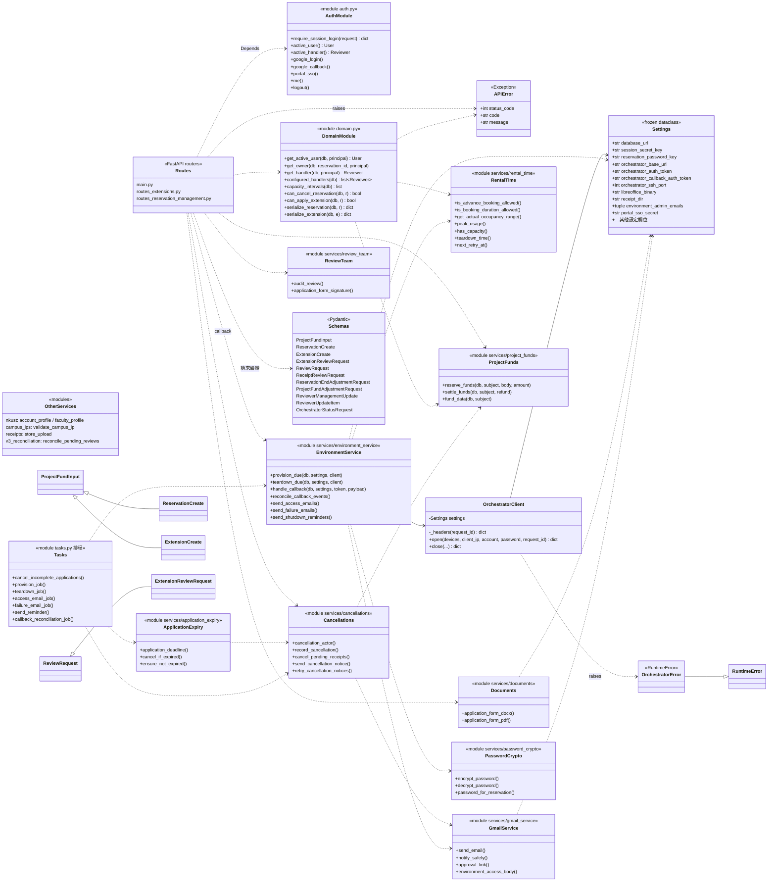
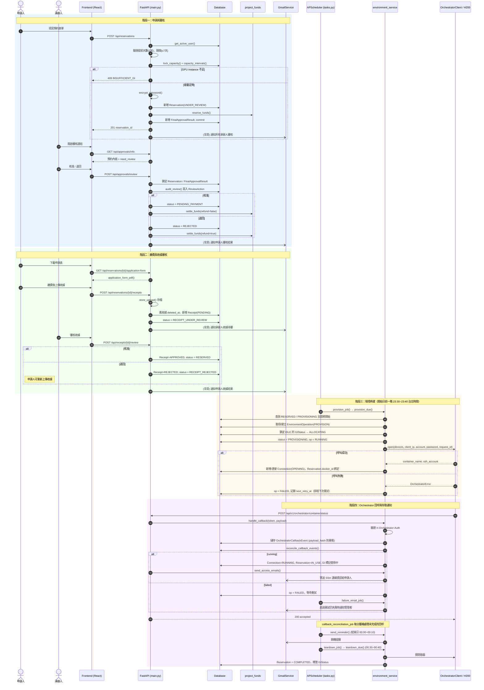
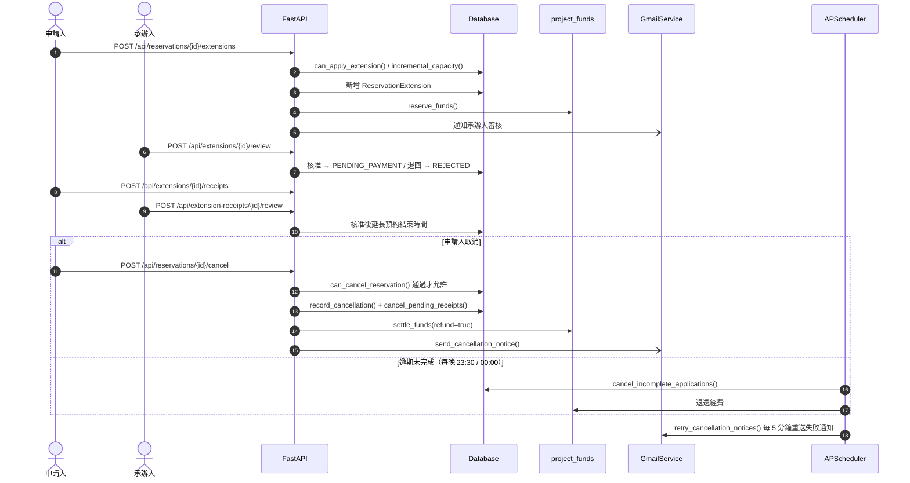
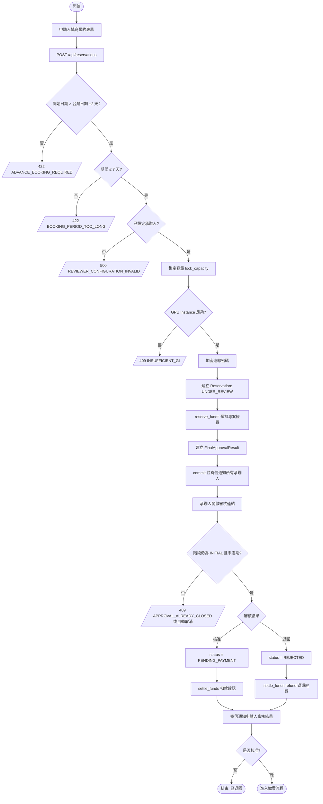
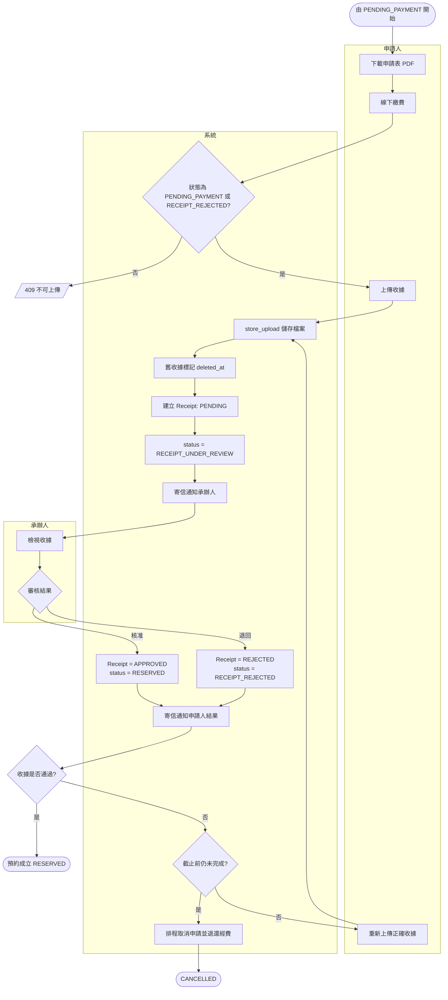
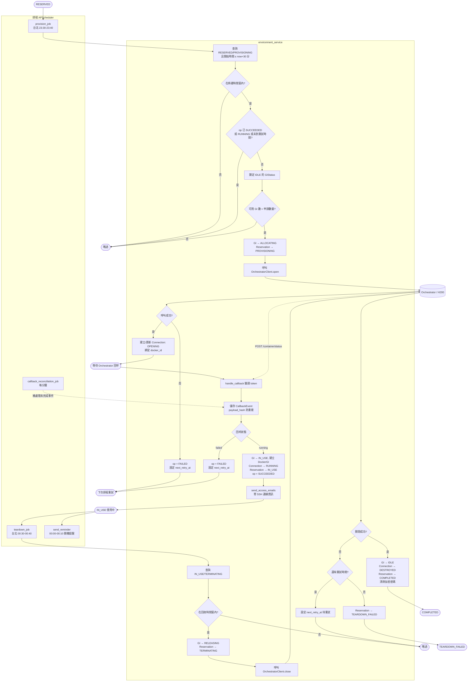
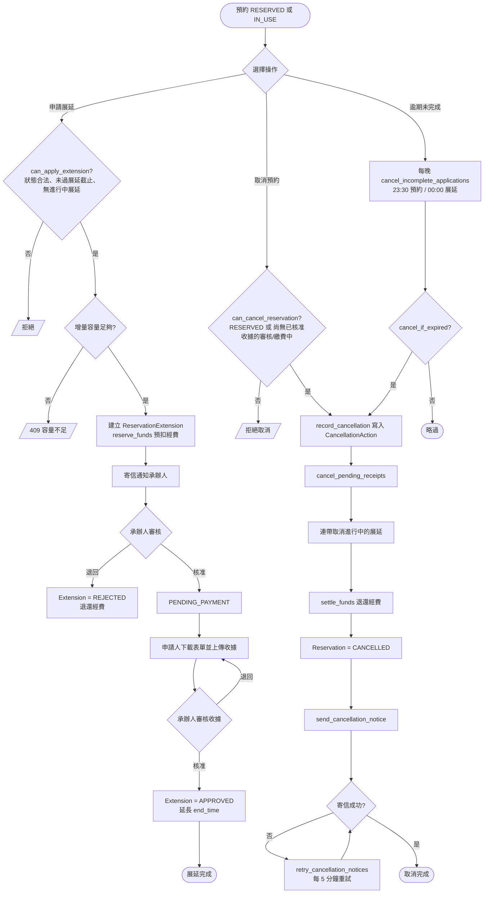

# 1. gpu-booking UML 類別圖

`gpu-booking` 是 FastAPI + SQLAlchemy 的後端，前端是 React/Vite。本文件以後端為主，分成領域模型（ORM）與服務層兩張圖；前端沒有類別，故略過。

## 1. 領域模型類別圖（`backend/models.py`）

```mermaid
classDiagram
direction TB

class Base {
    <<DeclarativeBase>>
}
class TimestampMixin {
    <<mixin>>
    +datetime created_at
    +datetime updated_at
    +datetime deleted_at
}

class User {
    +UUID user_id
    +str name
    +str email
}
class Reviewer {
    +UUID reviewer_id
    +str name
    +str position
    +str email
}
class Reservation {
    +UUID reservation_id
    +UUID user_id
    +int gi_quantity
    +str purpose
    +str project_funding_code
    +str purchase_request_number
    +str payer_name
    +str expense_category
    +str unit
    +str mobile
    +datetime start_time
    +datetime end_time
    +datetime billing_end_time
    +datetime paid_end_time
    +str connection_account
    +str connection_password
    +str connection_password_ciphertext
    +str connection_password_nonce
    +str connection_password_key_version
    +str source_ip
    +str status
    +str docker_id
}
class ReservationEndAdjustment {
    +UUID adjustment_id
    +UUID reservation_id
    +UUID reviewer_id
    +str reviewer_name
    +str reviewer_email
    +datetime previous_end_time
    +datetime new_end_time
    +str reason
    +datetime created_at
}
class ApplicantManager {
    +UUID reservation_id
    +str name
    +str position
    +str email
}
class ReviewerApprovalResult {
    +UUID reservation_id
    +UUID reviewer_id
    +str status
    +str reject_reason
}
class FinalApprovalResult {
    +UUID reservation_id
    +str manager_status
    +str manager_reject_reason
    +str final_status
    +str final_reject_reason
}
class Receipt {
    +UUID receipt_id
    +UUID reservation_id
    +str file_path
    +str status
    +str reject_reason
}

class ReservationExtension {
    +UUID extension_id
    +UUID reservation_id
    +datetime original_end_time
    +datetime requested_end_time
    +str purpose
    +str research_content
    +str project_funding_code
    +str purchase_request_number
    +str payer_name
    +str expense_category
    +str status
}
class ExtensionReviewerApprovalResult {
    +UUID extension_id
    +UUID reviewer_id
    +str status
    +str reject_reason
}
class ExtensionFinalApprovalResult {
    +UUID extension_id
    +str manager_status
    +str manager_reject_reason
    +str final_status
    +str final_reject_reason
}
class ExtensionReceipt {
    +UUID receipt_id
    +UUID extension_id
    +str file_path
    +str status
    +str reject_reason
}

class Connection {
    +str docker_id
    +str target_ip
    +str ssh_account
    +str page_url
    +str status
}
class GIStatus {
    +str gi_id
    +str status
}
class DockerGI {
    +str docker_id
    +str gi_id
}
class EnvironmentOperation {
    +UUID operation_id
    +UUID reservation_id
    +str operation_type
    +str status
    +str request_id
    +str assigned_gi_ids
    +str external_id
    +str response_payload
    +datetime next_retry_at
    +str error_message
    +int attempt_count
    +datetime access_email_sent_at
    +int access_email_attempt_count
    +datetime failure_email_sent_at
    +datetime shutdown_reminder_sent_at
    +int shutdown_reminder_attempt_count
}
class OrchestratorCallbackEvent {
    +UUID callback_id
    +str container_name
    +str status
    +str page_url
    +str target_ip
    +int port
    +str error_message
    +str raw_payload
    +str payload_hash
    +datetime processed_at
    +str processing_error
}

class ProjectFund {
    +str code
    +Decimal initial_amount
    +Decimal balance
    +datetime created_at
    +datetime approved_at
}
class ProjectFundUsage {
    +UUID usage_id
    +str fund_code
    +UUID reservation_id
    +UUID extension_id
    +Decimal requested_amount
    +Decimal deducted_amount
    +datetime created_at
    +datetime approved_at
    +datetime refunded_at
}
class ProjectFundAdjustment {
    +UUID adjustment_id
    +str fund_code
    +UUID reviewer_id
    +str reviewer_name
    +str reviewer_email
    +Decimal previous_initial_amount
    +Decimal new_initial_amount
    +Decimal delta_amount
    +Decimal previous_balance
    +Decimal new_balance
    +str reason
}

class ReviewAction {
    +UUID action_id
    +str target_kind
    +UUID target_id
    +str stage
    +UUID reviewer_id
    +str reviewer_name
    +str reviewer_email
    +str status
    +str reason
    +datetime created_at
}
class CancellationAction {
    +UUID action_id
    +UUID group_id
    +str target_kind
    +UUID target_id
    +UUID reservation_id
    +str previous_status
    +str actor_kind
    +UUID actor_principal_id
    +str actor_name
    +str actor_email
    +bool is_cascade
    +datetime notification_sent_at
    +datetime notification_next_retry_at
}
class UsedSsoTicket {
    +str jti
    +datetime expires_at
}

%% 繼承
TimestampMixin <|-- User
TimestampMixin <|-- Reviewer
TimestampMixin <|-- Reservation
TimestampMixin <|-- ApplicantManager
TimestampMixin <|-- ReviewerApprovalResult
TimestampMixin <|-- FinalApprovalResult
TimestampMixin <|-- Receipt
TimestampMixin <|-- ReservationExtension
TimestampMixin <|-- ExtensionReviewerApprovalResult
TimestampMixin <|-- ExtensionFinalApprovalResult
TimestampMixin <|-- ExtensionReceipt
TimestampMixin <|-- Connection
TimestampMixin <|-- GIStatus
TimestampMixin <|-- DockerGI
TimestampMixin <|-- EnvironmentOperation
TimestampMixin <|-- OrchestratorCallbackEvent
Base <|-- TimestampMixin
Base <|-- ReservationEndAdjustment
Base <|-- ProjectFund
Base <|-- ProjectFundUsage
Base <|-- ProjectFundAdjustment
Base <|-- ReviewAction
Base <|-- CancellationAction
Base <|-- UsedSsoTicket

%% 預約主線
User "1" --> "0..*" Reservation : user_id
Reservation "1" --> "0..1" Connection : docker_id (unique)
Reservation "1" --> "0..1" ApplicantManager
Reservation "1" --> "0..*" Receipt
Reservation "1" --> "0..*" ReservationEndAdjustment
Reservation "1" --> "0..*" EnvironmentOperation
Reservation "1" --> "0..1" FinalApprovalResult
Reservation "1" --> "0..*" ReviewerApprovalResult
Reviewer "1" --> "0..*" ReviewerApprovalResult
Reviewer "1" --> "0..*" ReservationEndAdjustment

%% 展延
Reservation "1" --> "0..*" ReservationExtension
ReservationExtension "1" --> "0..*" ExtensionReceipt
ReservationExtension "1" --> "0..1" ExtensionFinalApprovalResult
ReservationExtension "1" --> "0..*" ExtensionReviewerApprovalResult
Reviewer "1" --> "0..*" ExtensionReviewerApprovalResult

%% GPU / 容器
Connection "1" --> "0..*" DockerGI
GIStatus "1" --> "0..*" DockerGI

%% 經費
ProjectFund "1" --> "0..*" ProjectFundUsage : fund_code
ProjectFund "1" --> "0..*" ProjectFundAdjustment : fund_code
Reviewer "1" --> "0..*" ProjectFundAdjustment
Reservation "0..1" <-- "0..*" ProjectFundUsage : reservation_id (XOR)
ReservationExtension "0..1" <-- "0..*" ProjectFundUsage : extension_id (XOR)

%% 審核紀錄
Reviewer "1" --> "0..*" ReviewAction

%% 多型關聯（無實體 FK，用 target_kind + target_id 指向）
ReviewAction ..> Reservation : target_kind=RESERVATION
ReviewAction ..> ReservationExtension : target_kind=EXTENSION
CancellationAction ..> Reservation : reservation_id
CancellationAction ..> ReservationExtension : target_kind=EXTENSION
OrchestratorCallbackEvent ..> Connection : container_name ≈ docker_id
```

## 2. 服務層、設定與 API 結構

## 說明

- **預約流程**：`User` 建立 `Reservation`（核心聚合）。`Reservation` 底下掛：
  - 審核：`ReviewerApprovalResult`、`FinalApprovalResult`。
  - 收據：`Receipt`。
  - 展延：`ReservationExtension`，展延有自己的一套審核與收據。
  - 環境佈建：`EnvironmentOperation`，類型分 provision 與 teardown。
- **GPU 容器**：`Reservation` 以 `docker_id` 關聯 `Connection`。`Connection` 與 `GIStatus` 透過 `DockerGI` 形成多對多。
- **經費**：`ProjectFundUsage` 以 CHECK 約束保證 `reservation_id` 與 `extension_id` 二選一（XOR）。`ProjectFundAdjustment` 記錄審核者調整額度。
- **無外鍵的多型關聯**：
  - `ReviewAction` 與 `CancellationAction` 用 `target_kind` + `target_id` 指向 Reservation 或 Extension。
  - `OrchestratorCallbackEvent` 以 `container_name` 對應 `docker_id`。
  - 這些在圖中用虛線表示。
- **獨立實體**：`UsedSsoTicket` 用來防止 SSO ticket 被重複使用，與其他類別沒有關聯。
- **服務層**：這些是函式模組，不是 class，圖中以 `<<module>>` 標示。只有 `OrchestratorClient`、`Settings`、`APIError` 和 Pydantic schemas 是真正的類別。
- **畫法取捨**：Reservation 的 `status` 等狀態是字串，不是 Enum，所以圖中沒有畫 Enum 類別。

---

# 2. 循序圖

### 補充流程：展延與取消（摘要）

### 序列圖狀態對照

`Reservation.status` 在流程中依序變化：

`UNDER_REVIEW` → `PENDING_PAYMENT` → `RECEIPT_UNDER_REVIEW` → `RECEIPT_REJECTED`（可回到上傳）／`RESERVED` → `PROVISIONING` → `IN_USE` → `COMPLETED`

另有分支：`REJECTED`（承辦人退回）、`CANCELLED`（取消或逾期）。

> 註：`IN_USE` 由 `reconcile_callback_events()` 在收到 running 回呼時設定；`TERMINATING` → `COMPLETED` 由 `teardown_due()` 設定（關閉失敗且無法重試時為 `TEARDOWN_FAILED`）。

---

# 3. 活動圖

依據 `main.py`、`environment_service.py`、`tasks.py`、`domain.py` 的實際判斷分支繪製。

### 4.1 預約申請與審核流程

### 4.2 繳費與收據審核流程（含泳道）

### 4.3 環境佈建、回呼與回收流程

### 4.4 展延與取消流程

